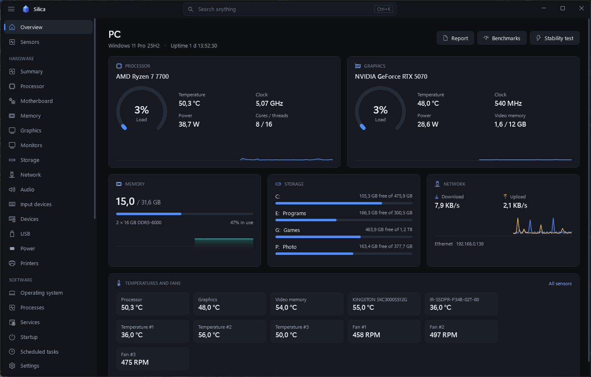
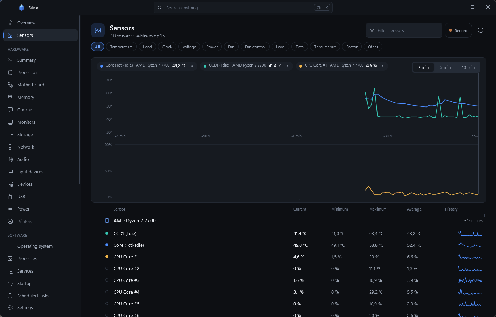
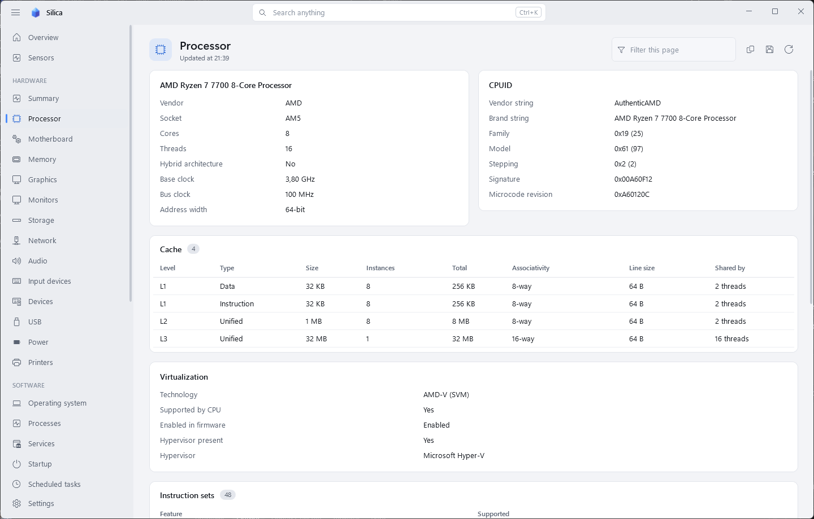
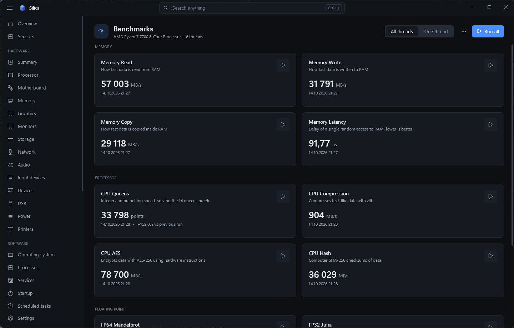
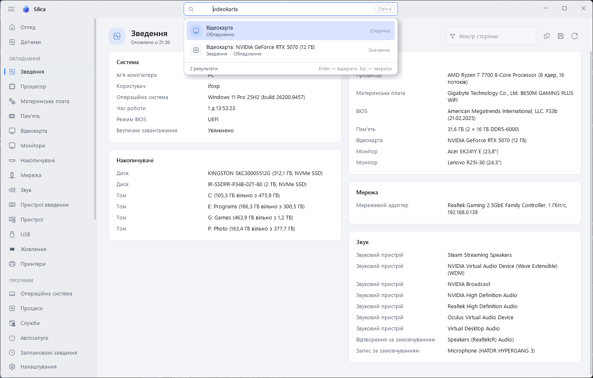

<p align="center">
  
</p>

<h1 align="center">Silica</h1>

<p align="center">
  System information, live sensors, benchmarks and a stability test for Windows.<br>
  Free, open source, no accounts, no subscriptions, no telemetry.
</p>

<p align="center">
  <a href="#українською">Українською</a>
</p>



## What it does

- **Every detail of the machine.** 28 pages: processor with CPUID and instruction sets, motherboard and BIOS, memory modules, graphics, monitors with EDID, drives with health and wear, network adapters, audio, input and USB devices, power and battery, operating system, processes, services, startup entries, scheduled tasks, installed programs and Store apps, drivers, updates, security (Defender, firewall, TPM, BitLocker, VBS), users, environment, shares, fonts and the event log.
- **Live sensors.** Temperatures, clocks, voltages, power, fans, loads and throughput with minimum, maximum and average, sparklines and charts you build by clicking sensors.
- **Overview.** The important numbers on one screen: processor, graphics, memory, drives, network, temperatures and fans.
- **Benchmarks.** Memory read, write, copy and latency, integer, compression, AES and SHA-256, FP32 and FP64 math. Results are kept, compared with your previous runs, and can be exported to compare with another computer.
- **Disk benchmark.** Sequential and random speed with the Windows cache bypassed, with IOPS and latency.
- **Stability test.** Processor, floating point, cache, memory and disk loads where every result is verified, so an unstable overclock shows up as errors. Watches for clock throttling while it runs.
- **Monitor test.** Full-screen patterns for dead pixels, uniformity, gradients, sharpness and motion.
- **Reports.** A clean web page that prints well, plain text, Markdown or JSON.
- **Search that forgives.** Finds pages, settings, sensors and any value in any installed language at once, with typos, partial words, transliteration ("videokarta") and a wrong keyboard layout ("ghjwtcjh" finds "процесор").
- **Tray, overlay, logging and alerts.** Sensor values in the notification area, a small always-on-top panel, CSV logging and notifications when a value crosses a limit.

Silica only does work you ask for. Pages are read when you open them, and sensors are polled only while something shows or records them: a minimized window uses no processor time unless the tray, overlay, logging or alerts need live values.

Memory is kept low the same way. Sensors run in a second `Silica.exe` process that closes a minute after nothing needs them, which returns the memory the sensor library and driver hold. On screens up to 2560×1600 the interface is drawn by the processor, about 50 MB less than drawing on the graphics card; **Settings → Appearance → Drawing** changes it. A hidden or minimized window gives its memory back to Windows.

| | |
|---|---|
|  |  |
|  |  |

## Requirements

- Windows 10 or 11, 64-bit.
- Administrator rights. Silica asks for them at start because temperatures, fan speeds and drive health are not readable otherwise. If you decline, it runs in a limited mode and offers to restart with rights later.
- [PawnIO](https://pawnio.eu) for processor temperatures and motherboard sensors. Silica tells you when it is missing.

## Download and run

- **Installer:** `Silica-<version>-uk.msi` or `Silica-<version>-en.msi`. Installs to Program Files and adds a Start menu entry.
- **Portable:** unzip `Silica-<version>-portable.zip` and run `Silica.exe`. To keep settings next to the program instead of `%AppData%\Silica`, create an empty `Silica.settings.json` beside it.

**Start with Windows** is available only in the installed version. The startup task runs Silica with administrator rights, so the program file has to sit in Program Files, where other programs cannot replace it.

Windows 11 puts new tray icons into the overflow area. To keep a sensor visible, drag its icon from the overflow to the taskbar once.

## Build from source

You need the [.NET 9 SDK](https://dotnet.microsoft.com/download) and Python 3 (only for the release script).

```powershell
dotnet build Silica.sln                 # debug build
.\build.ps1 -Version 1.0.0              # portable zip and both installers in .\artifacts
```

Command line:

```powershell
Silica.exe --report report.html         # write a report without opening a window (.html, .txt, .md, .json);
                                        # run it from an administrator terminal for drive health and TPM data
Silica.exe --lang en                    # start in a given language
```

## Languages

52 languages are built in: English, Ukrainian, Arabic, Armenian, Azerbaijani, Basque, Belarusian, Bengali, Bosnian, Bulgarian, Catalan, Chinese (Simplified and Traditional), Croatian, Czech, Danish, Dutch, Estonian, Finnish, French, Galician, Georgian, German, Greek, Hebrew, Hindi, Hungarian, Icelandic, Indonesian, Italian, Japanese, Kazakh, Korean, Latvian, Lithuanian, Macedonian, Malay, Norwegian, Persian, Polish, Portuguese (Portugal and Brazil), Romanian, Serbian (Latin), Slovak, Slovenian, Spanish, Swedish, Thai, Turkish and Vietnamese. Silica picks the Windows display language on first start. Arabic, Hebrew and Persian use a right-to-left layout.

English and Ukrainian are written by hand; the other languages are machine-assisted and welcome corrections from native speakers. Any text missing from a language is shown in English, so a partial translation is still usable.

To add or fix a language (a single JSON file):

1. In Silica, open **Settings → Language → Create translation template**.
2. Translate the values (the keys are the English texts) and set the language code and name at the top.
3. Put the file into the languages folder (**Open languages folder**) and press **Reload languages**.

`plural` selects how counts are written (`none`, `one-other`, `zero-one-other`, `east-slavic`, `polish`, `czech`, `lithuanian`, `latvian`, `romanian`, `slovenian`, `arabic`, `hebrew`). Forms are separated by `|`, for example `"{0} датчик|{0} датчики|{0} датчиків"`. The `synonyms` section adds search words. Settings shows how complete each language is.

For contributors: [tools/TRANSLATING.md](tools/TRANSLATING.md) has the rules. `python tools/i18n.py` refreshes `en.json` from the source and lists missing keys per language; `python tools/check_lang.py` checks placeholders and plural forms.

## Project layout

```
src/Silica.Core   information pages, sensors, benchmarks, stability test, reports (no UI)
src/Silica        WPF application
installer         WiX installer
tools             language tooling, icon generator
```

## Privacy

Silica makes no network connections. Reports, logs and benchmark results stay on your computer unless you share them.

## License

MIT, see [LICENSE](LICENSE). Sensor access uses [LibreHardwareMonitor](https://github.com/LibreHardwareMonitor/LibreHardwareMonitor) (MPL 2.0) and the [PawnIO](https://pawnio.eu) driver.

---

## Українською

**Silica** — безкоштовна програма з відкритим кодом для Windows: повні відомості про комп'ютер, живі датчики, тести продуктивності й тест стабільності. Без облікових записів, підписок і телеметрії.

- **28 сторінок відомостей** про залізо й систему: процесор з CPUID, материнська плата й BIOS, модулі пам'яті, відеокарта, монітори, диски зі станом і зносом, мережа, звук, USB, живлення, ОС, процеси, служби, автозапуск, програми, драйвери, оновлення, безпека та інше.
- **Датчики** з мінімумом, максимумом і середнім, міні-графіками та великими графіками за кліком.
- **Огляд**: усе головне на одному екрані.
- **Тести продуктивності** пам'яті, процесора й дробових обчислень з історією та порівнянням з іншим комп'ютером.
- **Тест диска** в обхід кешу Windows, **тест стабільності** з перевіркою кожного результату, **тест монітора**.
- **Звіти** у вигляді вебсторінки, тексту, Markdown чи JSON.
- **Розумний пошук**: розуміє будь-яку встановлену мову, помилки, транслітерацію й неправильну розкладку.
- **Трей, оверлей, запис у CSV і сповіщення.**

Програма працює лише тоді, коли це потрібно: згорнуте вікно не навантажує процесор, якщо датчики не потрібні трею, оверлею, запису чи сповіщенням. Датчики працюють в окремому процесі `Silica.exe`, який закривається через хвилину після того, як стали не потрібні, і звільняє пам'ять. На екранах до 2560×1600 інтерфейс малює процесор, це приблизно на 50 МБ менше пам'яті (змінюється в «Налаштування → Вигляд → Відтворення інтерфейсу»).

**Вимоги:** Windows 10/11 x64, права адміністратора (без них — обмежений режим), драйвер [PawnIO](https://pawnio.eu) для температур процесора й датчиків материнської плати.

**Автозапуск** доступний лише у встановленій версії: завдання запускає Silica з правами адміністратора, тож файл програми має лежати в Program Files, де його не підмінить інша програма.

**Мови:** вбудовано 52 мови, зокрема українську та англійську (написані вручну; решта перекладена з допомогою машинного перекладу, виправлення від носіїв мови вітаються). Якщо в мові бракує якогось тексту, він показується англійською. Нова мова — один файл JSON: «Налаштування → Мова → Створити шаблон перекладу», перекладіть значення й покладіть файл у папку мов.
